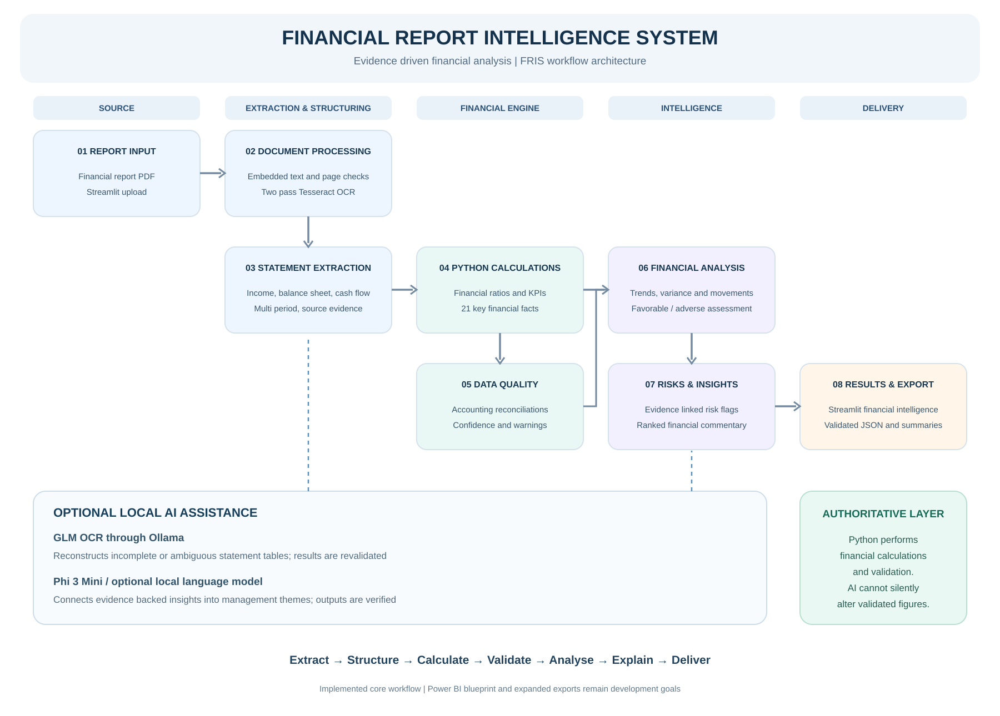

# Financial Report Intelligence System (FRIS)

> A financial analysis application that extracts financial statement data from corporate PDFs, calculates auditable financial metrics, identifies performance movements and risks, and generates evidence linked insights.

**Status:** Working Version 1 with further modules planned  
**Core stack:** Python, Streamlit, PyMuPDF, Tesseract OCR, Pandas, Ollama with optional GLM OCR and Phi 3 Mini  
**Repository:** [Financial Report Intelligence System](https://github.com/TeslimAdeyanju/Financial-Report-Intelligence-System)



## Executive Summary

Financial reports contain large volumes of financial statement information that analysts otherwise extract, reconcile and interpret manually. FRIS brings these steps into a single, traceable workflow. It reads annual report PDFs, selects the primary statements, extracts values across reporting periods, applies deterministic Python calculations, validates accounting relationships and produces financial movements, risk flags and management insights.

AI is optional. Local models can help reconstruct ambiguous tables or combine validated insights into management themes. They cannot silently overwrite confirmed figures or become the authoritative calculation engine. The implementation currently centres on PDF reports and a Streamlit interface, with wider export and dashboard functionality documented as future work.

## Business Problem and Objectives

The project addresses the time and error risk of manual statement extraction and financial performance review. Its objectives are to preserve source evidence, calculate comparable KPIs across reporting periods, check extracted figures, identify material movements and communicate financial implications without presenting guessed business drivers as facts.

## Verified Project Results

The repository records the following checks from sample annual reports. These are project validation snapshots, not claims of general accuracy across all financial statements.

| Sample report | Income rows | Balance sheet rows | Cash flow rows | Validation checks |
| --- | ---: | ---: | ---: | ---: |
| Apple 2022 Form 10 K | 19 | 27 | 33 | 12/12 |
| Amazon 2025 annual report | 23 | 26 | 29 | 10/10 |
| Colgate 2025 annual report | 17 | 31 | 33 | 15/15 |

These figures are documented in [development history](docs/development-history.md). For current, reproducible behaviour, run the automated tests and review the underlying PDFs.

## Data Sources and Scope

Sample PDF reports are located under `sample_reports/` and include Apple, Amazon and Colgate. Reporting periods, currencies, statement labels, numerical scales and PDF page references are retained when extracted. FRIS does not assume that missing financial facts equal zero.

## Workflow and Architecture

1. **Upload and inspect.** Streamlit accepts a PDF and the document agent checks embedded text quality.
2. **Recover readable statements.** Corrupt or image based text can trigger two pass Tesseract OCR. Primary statement pages are selected.
3. **Extract structured data.** Income, balance sheet and cash flow rows retain labels, periods, currency, scale and source evidence.
4. **Calculate and validate.** Deterministic Python computes ratios and checks statement reconciliations.
5. **Assist only when needed.** In automatic mode, incomplete or invalid extraction may invoke local GLM OCR through Ollama; any recovered figures pass through calculations and validation again. Rules only and model assisted modes are also available.
6. **Analyse financial movements.** Python computes adjacent period changes and performance assessments.
7. **Assess risks and generate insights.** Evidence linked findings address profitability, liquidity, solvency, cash flow and reporting quality.
8. **Optional narrative assistance.** A local language model can combine validated insights into management themes. Its content undergoes numerical and provenance verification, with deterministic fallback.
9. **Present and export.** Streamlit shows the available outputs and the implemented JSON analysis export supports downstream processing.

For more on pipeline design, see [architecture documentation](docs/architecture.md). The orchestration entry point is `backend/fris/pipeline.py`.

## Methodology and Technical Implementation

| Component | Primary responsibility |
| --- | --- |
| Document processing | PDF parsing, page selection, OCR and optional visual extraction |
| Statement and facts extraction | Structured multi period statements and canonical financial facts |
| Financial calculation engine | Python based ratios, margins and financial KPIs |
| Data quality | Accounting and cash flow reconciliations, warnings |
| Financial analysis | Period movements, trend and variance classification |
| Risk assessment | Traceable risk flags with severity and review prompts |
| Insight generation | Ranked evidence based commentary and optional verified synthesis |
| Narrative synthesis | Baseline summary |
| Streamlit | User controls, inspection and result presentation |

Agent 08, the Power BI visual blueprint, and Agent 10, the expanded export module, remain development goals rather than fully implemented stages of the orchestrator.

## Validation and Model Boundaries

FRIS applies balance sheet, gross profit, liquidity and cash flow reconciliation checks where the necessary figures exist. The model assisted path is only an aid to extraction or phrasing. Calculations remain deterministic. Invalid or unavailable model output falls back to rules based results. Derived financial observations are not proof of the underlying commercial causes.

Run the repository's tests to inspect the actual validation coverage:

```bash
pytest
```

## Getting Started

Requires an appropriate Python installation. For image based reports, install a local Tesseract OCR runtime. Ollama models are optional.

```bash
git clone https://github.com/TeslimAdeyanju/Financial-Report-Intelligence-System.git
cd Financial-Report-Intelligence-System
python3 -m venv .venv
source .venv/bin/activate
python -m pip install -r development/requirements.txt
streamlit run app.py
```

For optional model assisted extraction, install and run Ollama, then obtain the configured GLM OCR model:

```bash
ollama pull glm-ocr:latest
```

On macOS, Tesseract can be installed with `brew install tesseract`. The basic workflow can be run without the Ollama model.

## Repository Structure

```text
app.py                        Streamlit interface
backend/fris/pipeline.py      Pipeline orchestrator
backend/fris/agents/          Numbered financial processing modules
backend/fris/models.py        Shared domain models
sample_reports/               Sample corporate annual report PDFs
development/tests/            Automated tests
docs/                         Architecture and development history
docs/assets/                  Workflow visualisations
```

## Current Limitations and Roadmap

The current implemented pipeline focuses on corporate PDF statements, source level evidence, financial ratios, risks, insights and JSON outputs. Future capabilities include broader file types, more robust visual table reconstruction, wider LLM benchmarking, Power BI semantic blueprints and additional export formats. Do not assume those features are available now.

Technical checkpoints, model benchmarks and dated implementation notes are preserved in [Development History](docs/development-history.md).

## Professional and Technical Notes

FRIS provides analytical assistance rather than audited financial assurance or investment advice. Users should confirm source statements and interpretations before consequential decisions.

**Author:** [Teslim Adeyanju](https://github.com/TeslimAdeyanju) | [Portfolio](https://adeyanjuteslim.co.uk)

